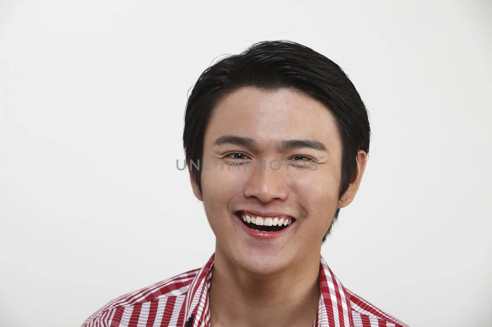
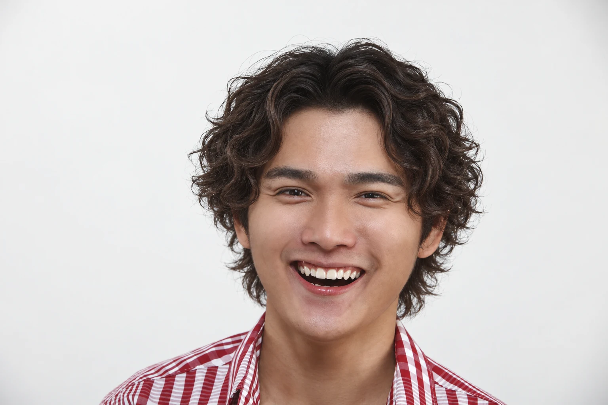
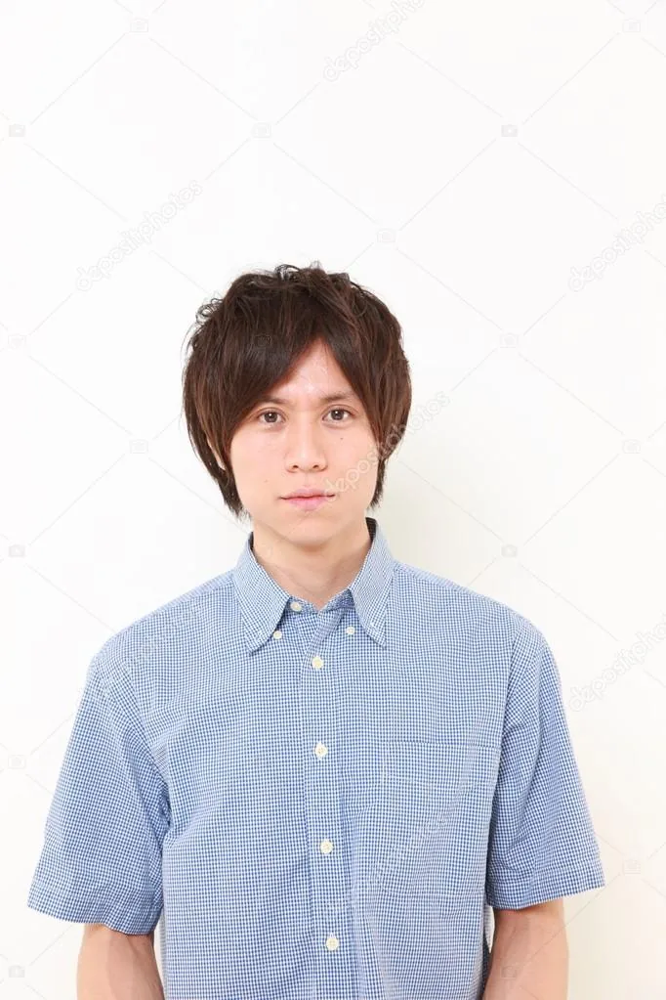
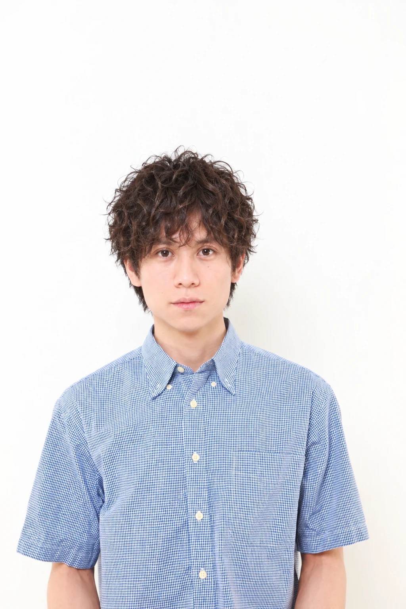
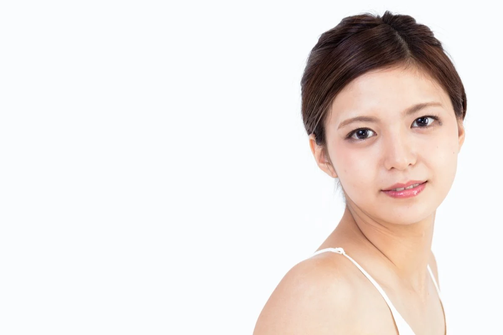
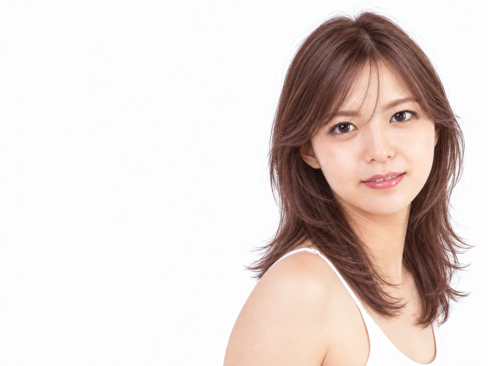
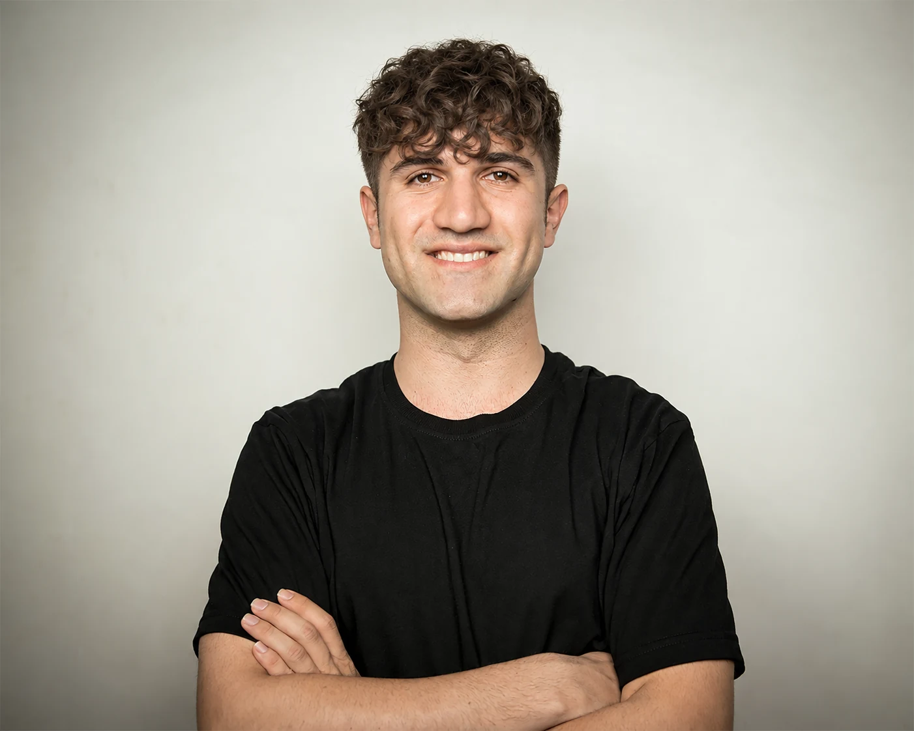
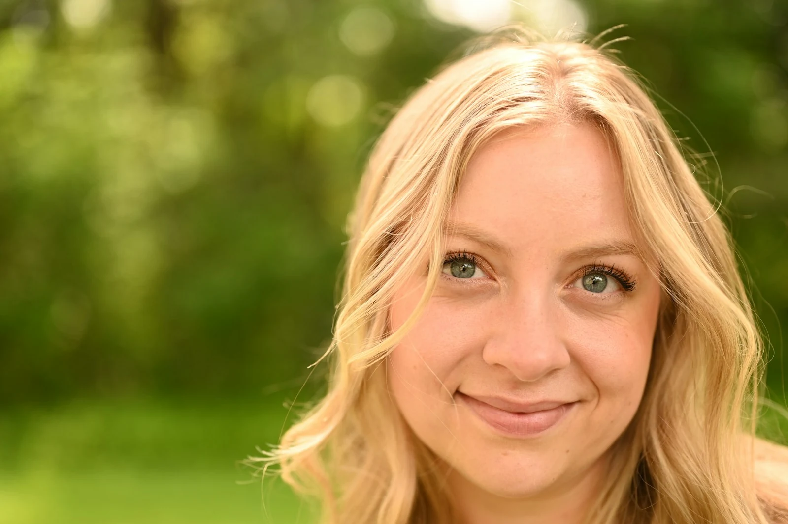

# Hairstyle Try-on · Teste virtual de penteados

[English](README.md) | [简体中文](README.zh-CN.md) | [Español](README.es.md) | [Français](README.fr.md) | Português | [Русский](README.ru.md) | [한국어](README.ko.md) | [日本語](README.ja.md)

Uma skill do Codex para receber recomendações realistas de penteados e experimentá-los virtualmente a partir de uma selfie.

Envie uma selfie e, se quiser, uma imagem do penteado desejado. O Codex recomenda 4–6 propostas completas com base nas características do seu cabelo e na sua rotina diária. Depois de escolher suas favoritas, o imagegen integrado gera uma foto de teste para cada proposta, além de uma página de comparação e uma ficha em linguagem simples para compartilhar com seu cabeleireiro ou cabeleireira.

## Exemplos

8 casos de teste com retratos e 24 resultados de IA, todos em WebP. Última atualização: 2026-10-13. São simulações visuais, não fotos de cortes reais antes e depois nem recomendações das pessoas retratadas. A galeria explica a origem das imagens, as ampliações do enquadramento e as áreas reconstruídas.

[Ver os 24 resultados, comparações e créditos](examples/README.md)

| Original | Teste com IA |
| --- | --- |
| **CNM01**<br><a href="examples/cnm01/original.webp"></a> | **H04 · Wolf cut cacheado castanho suave**<br><a href="examples/cnm01/h04.webp"></a> |
| **JPM01**<br><a href="examples/jpm01/original.webp"></a> | **H03 · Cachos espirais castanho-escuro frio**<br><a href="examples/jpm01/h03.webp"></a> |
| **KR01**<br><a href="examples/kr01/original.webp"></a> | **H02 · Bob reto castanho-bege**<br><a href="examples/kr01/h02.webp"></a> |
| **JP01**<br><a href="examples/jp01/original.webp"></a> | **H03 · Camadas na clavícula em castanho rosado · v2**<br><a href="examples/jp01/h03.webp"></a> |
| **P02**<br><a href="examples/p02/original.webp"></a> | **H02 · Franja cacheada**<br><a href="examples/p02/h02.webp"></a> |
| **W02**<br><a href="examples/w02/original.webp"></a> | **H01 · Bob francês castanho quente**<br><a href="examples/w02/h01.webp"></a> |
| **W03**<br><a href="examples/w03/original.webp"></a> | **H04 · Bob liso com óculos**<br><a href="examples/w03/h04.webp"></a> |

## Como funciona

1. Envie uma selfie nítida, de frente. Fotos de perfil, da parte de trás da cabeça e do penteado desejado são opcionais.
2. Escolha as opções que descrevem seu cabelo, se aceita permanente ou coloração, quanto tempo dedica ao penteado e o que quer evitar. Também é possível responder «Não sei» ou escrever livremente.
3. Veja as propostas com imagens de referência, motivos da recomendação, condições necessárias para obter o resultado e links para as fontes.
4. Por padrão, selecione 1–3 propostas, com uma foto gerada para cada uma. Você pode solicitar explicitamente um número maior de propostas.
5. Analise as fotos individuais e a comparação lado a lado; depois, solicite ajustes pelo identificador da proposta.

Os penteados são organizados por comprimento e características, para pessoas de todos os gêneros. Um penteado de referência é adaptado às condições do seu próprio cabelo. Cada geração usa a selfie original como referência da sua aparência.

## Requisitos

Este repositório contém instruções de uma skill, não um modelo de imagens, um serviço de API ou a implementação de um plugin. É necessário um ambiente Codex que permita usar skills locais, visualizar imagens e acessar o imagegen integrado.

| Ferramenta | Finalidade | Se estiver indisponível |
| --- | --- | --- |
| imagegen integrado ao Codex | Gerar e editar fotos de teste | Manter as propostas e explicar a limitação; nunca mudar automaticamente para uma API paga |
| Exa (opcional) | Opção preferencial para pesquisar e consultar fontes sobre penteados | Usar uma pesquisa comum na web |
| TypeSafe (opcional) | Filtrar e ordenar as descrições das propostas | O Codex faz a seleção |
| Interactive Form Save (opcional) | Coletar preferências, seleções múltiplas e ler as respostas enviadas | Usar opções numeradas e respostas em texto livre |

O fluxo com imagegen integrado não exige configurar `OPENAI_API_KEY`. A disponibilidade, as cotas e os termos de uso das ferramentas externas dependem dos respectivos serviços; este repositório não inclui acesso a eles.

## Instalação

Clone ou extraia este repositório para uma pasta chamada `hairstyle-tryon`, dentro do diretório de skills configurado no seu Codex:

```text
seu-diretorio-de-skills/
└── hairstyle-tryon/
    ├── SKILL.md
    ├── README.md
    ├── README.zh-CN.md
    ├── README.es.md
    ├── README.fr.md
    ├── README.pt.md
    ├── README.ru.md
    ├── README.ko.md
    ├── README.ja.md
    ├── examples/
    └── LICENSE
```

Se `CODEX_HOME` estiver configurado, você pode usar o subdiretório `skills`. Antes de instalar, verifique se já existe uma pasta com o mesmo nome e preserve as alterações locais. Evite colocar os arquivos dentro de duas pastas `hairstyle-tryon` aninhadas.

## Uso

Invoque a skill no Codex e anexe sua foto. Por exemplo:

```text
Use $hairstyle-tryon para me ajudar a encontrar um penteado para ir trabalhar.
Quero manter minha cor atual, sem permanente, e dedicar cerca de 5 minutos por dia para arrumar o cabelo.
Vou enviar uma selfie de frente. Deixe-me escolher várias propostas antes de gerar as fotos de teste.
```

Se você tiver uma imagem do penteado desejado, anexe-a também e diga quais características mais quer preservar. Depois, pode pedir alterações como: «Encurte um pouco a franja de H02 e mantenha todo o resto igual».

## Entregas

Por padrão, os resultados são salvos em `output/hairstyle-tryon/<identificador-unico-da-execucao>/` no espaço de trabalho da tarefa. Você pode indicar outro diretório.

- Uma foto de teste para cada proposta, com nome baseado no identificador e na versão.
- `comparison.html`: uma página de comparação lado a lado que referencia a foto original e as imagens geradas.
- `notes.md`: fontes, instruções de geração, resultados da revisão e uma ficha para cada penteado.

A ficha do penteado é uma nota simples para mostrar no salão: quais características preservar, quais mudanças você aceita, sua rotina de cuidados e o que precisa ser avaliado pessoalmente. Ela não é uma receita técnica de corte nem uma garantia de resultado.

## Validação e uso de imagens

A versão da skill é `v0.1.0`. Oito testes com retratos produziram 24 resultados finais com imagegen integrado em 2026-09-28, 2026-10-12 e 2026-10-13; as verificações visuais e dos arquivos estão na [galeria](examples/README.md). O fluxo com uma selfie do próprio usuário e os resultados de cortes reais ainda não foram validados. A preservação da aparência depende das instruções e da revisão visual, sem garantia de correspondência pixel a pixel.

O repositório contém a skill, documentação e demonstrações selecionadas em `examples/`, sujeitas aos [créditos e termos de uso das imagens](examples/CREDITS.md). Não contém selfies de usuários nem formulários privados. As fotos de cada execução são usadas para aquela solicitação. Antes de publicar, confira os arquivos preparados para o commit para evitar incluir fotos privadas, resultados sem relação ou credenciais. As pastas de saída e de entrada local mais comuns continuam excluídas pelo `.gitignore`.

## Contato

Grupo no QQ: `1094787834`.

## Licença

As instruções da skill e a documentação são distribuídas sob a [licença MIT](LICENSE). O texto padrão está disponível na [Open Source Initiative](https://opensource.org/license/mit). Essa licença não concede direitos adicionais sobre fotos de usuários, imagens de referência da Internet ou serviços externos.
