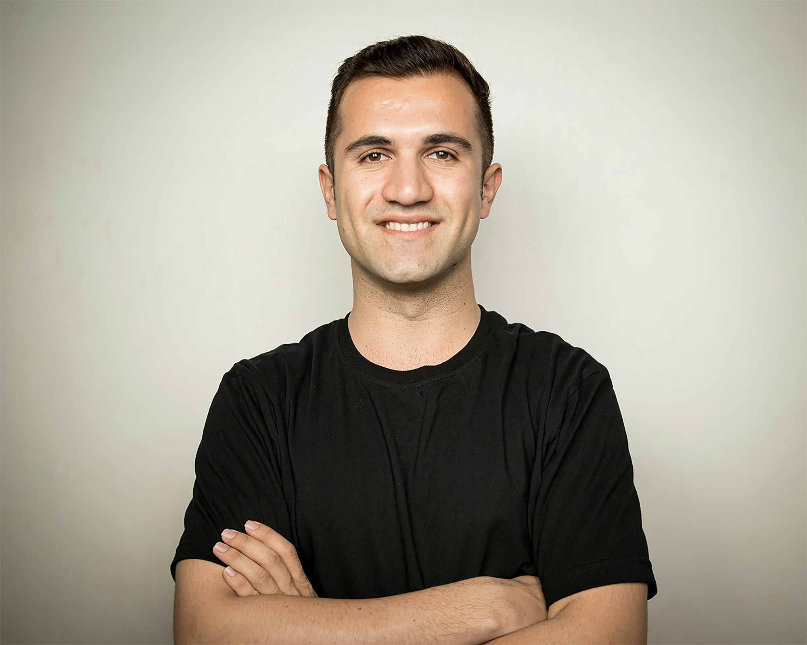
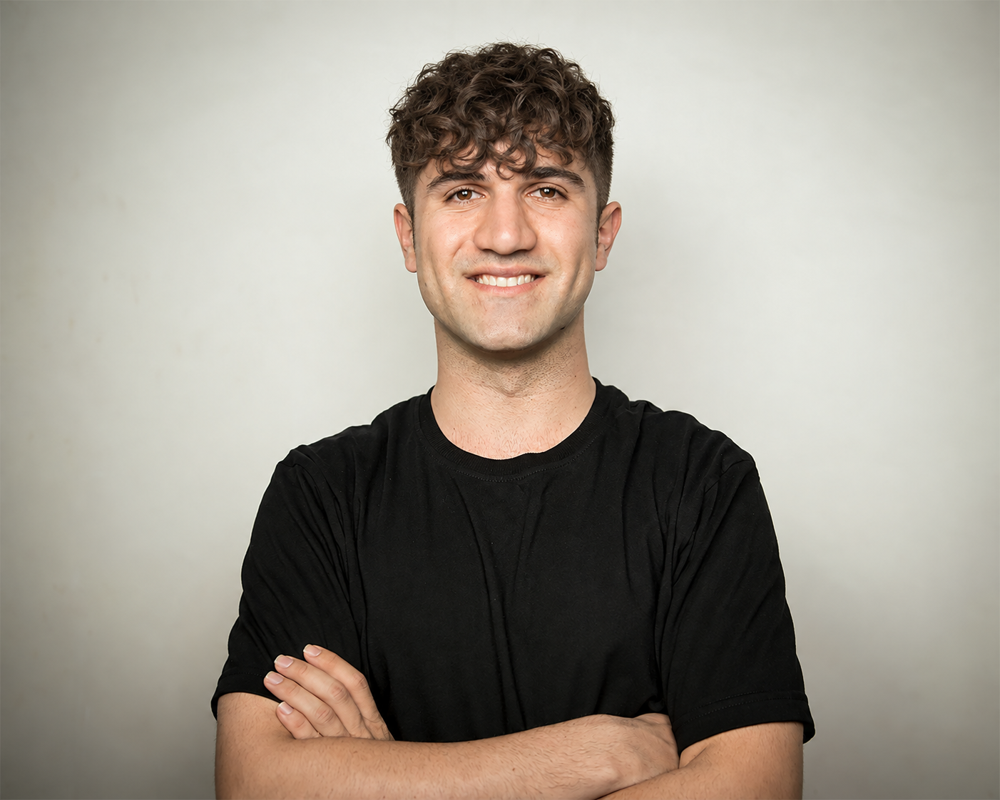
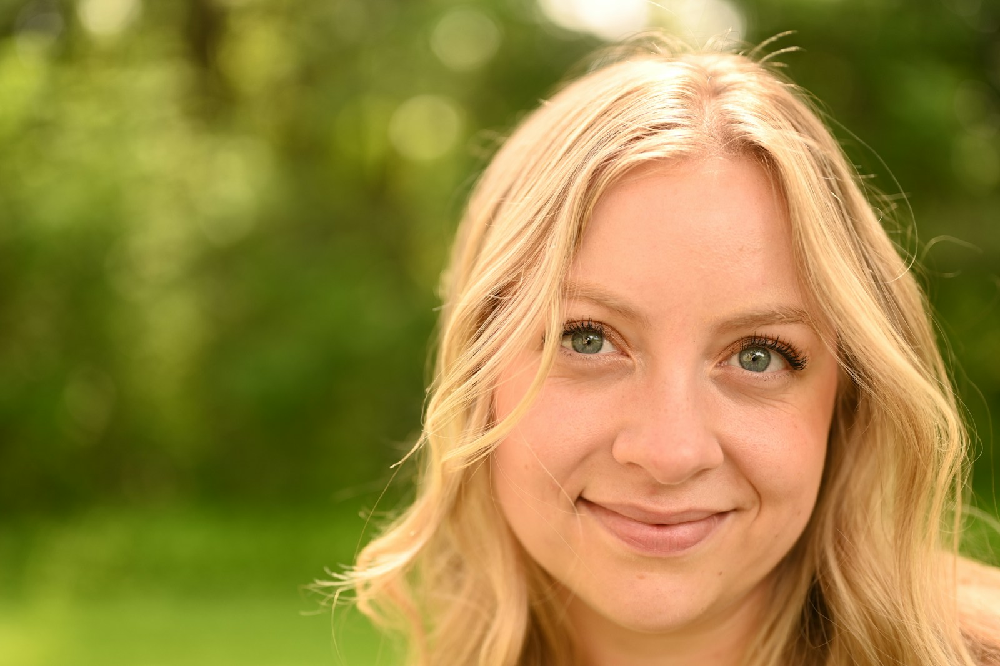
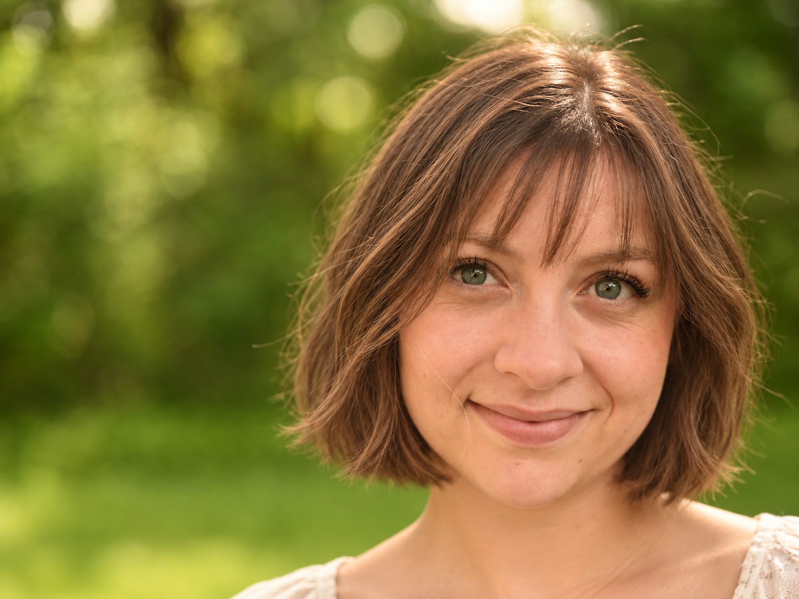

# Hairstyle Try-on · Виртуальная примерка причёсок

[English](README.md) | [简体中文](README.zh-CN.md) | [Español](README.es.md) | [Français](README.fr.md) | [Português](README.pt.md) | Русский | [한국어](README.ko.md) | [日本語](README.ja.md)

Навык Codex для подбора реалистичных вариантов причёсок и их виртуальной примерки по селфи.

Предоставьте селфи и, при желании, фотографию желаемой причёски. Codex предложит 4–6 полных вариантов с учётом особенностей ваших волос и повседневного ухода. После выбора встроенный imagegen создаст отдельное фото с каждым вариантом, а также страницу для сравнения и понятную памятку для парикмахера.

## Примеры

Результаты 4 тестов со стоковыми фотографиями: 12 изображений с ИИ-примеркой. Это симуляции, а не фотографии реальных стрижек до и после и не рекомендации изображённых людей. В W02 кадр расширен вниз; добавленные шея, одежда и фон созданы ИИ на основе предположений.

[Все 12 результатов, сравнения и сведения об авторах фото](examples/README.md)

| Оригинал | ИИ-примерка |
| --- | --- |
| **P02**<br><a href="examples/p02/original.jpg"></a> | **H02 · Кудрявая чёлка**<br><a href="examples/p02/h02.png"></a> |
| **W02**<br><a href="examples/w02/original.jpg"></a> | **H01 · Французский боб, тёплый каштановый**<br><a href="examples/w02/h01.png"></a> |
| **W03**<br><a href="examples/w03/original.jpg"></a> | **H04 · Гладкий боб с очками**<br><a href="examples/w03/h04.png"></a> |

## Как это работает

1. Предоставьте чёткое селфи анфас. Фотографии сбоку, сзади и изображение желаемой причёски необязательны.
2. Выберите варианты ответов об особенностях волос, готовности к завивке или окрашиванию, времени на ежедневную укладку и нежелательных изменениях. Можно ответить «Не знаю» или описать пожелания своими словами.
3. Просмотрите предложения с фотографиями для ориентира, обоснованием рекомендаций, условиями для достижения результата и ссылками на источники.
4. По умолчанию выберите 1–3 варианта: для каждого будет создано отдельное фото. Можно явно запросить больше.
5. Сравните отдельные фотографии и изображения рядом, затем запросите изменения по идентификатору варианта.

Причёски сгруппированы по длине и особенностям и подходят для подбора людям любого гендера. Причёска с референса адаптируется к вашим волосам. При каждой генерации исходное селфи используется как образец вашей внешности.

## Требования

Репозиторий содержит инструкции навыка, а не модель генерации изображений, API-сервис или реализацию плагина. Нужна среда Codex с поддержкой локальных навыков, просмотра изображений и встроенного imagegen.

| Инструмент | Назначение | Если недоступен |
| --- | --- | --- |
| Встроенный imagegen в Codex | Создание и редактирование фото с примеркой причёсок | Сохранить предложенные варианты и объяснить ограничение; не переходить автоматически на платный API |
| Exa (необязательно) | Предпочтительный поиск и чтение источников о причёсках | Использовать обычный веб-поиск |
| TypeSafe (необязательно) | Отбор и ранжирование текстовых описаний вариантов | Отбор выполняет Codex |
| Interactive Form Save (необязательно) | Сбор пожеланий, выбор нескольких вариантов и чтение отправленных ответов | Использовать пронумерованные варианты и ответы в свободной форме |

Для работы со встроенным imagegen не нужно настраивать `OPENAI_API_KEY`. Доступность, лимиты и условия использования внешних инструментов определяются соответствующими сервисами; этот репозиторий не предоставляет к ним доступ.

## Установка

Клонируйте или распакуйте репозиторий в папку `hairstyle-tryon` внутри настроенного каталога навыков Codex:

```text
каталог-навыков/
└── hairstyle-tryon/
    ├── SKILL.md
    ├── README.md
    ├── README.zh-CN.md
    ├── README.es.md
    ├── README.fr.md
    ├── README.pt.md
    ├── README.ru.md
    ├── README.ko.md
    ├── README.ja.md
    ├── examples/
    └── LICENSE
```

Если задан `CODEX_HOME`, можно использовать его подкаталог `skills`. Перед установкой проверьте, нет ли уже одноимённой папки, и сохраните локальные изменения. Не размещайте файлы в двух вложенных друг в друга папках `hairstyle-tryon`.

## Использование

Вызовите навык в Codex и приложите фотографию. Например:

```text
Используй $hairstyle-tryon, чтобы подобрать мне причёску для повседневной работы.
Хочу сохранить текущий цвет волос, без химической завивки, и тратить на укладку около 5 минут в день.
Я загружу селфи анфас. Сначала дай мне выбрать несколько вариантов, а затем создай фото с примеркой.
```

Если есть изображение желаемой причёски, приложите его и укажите, какие особенности важнее всего сохранить. Затем можно попросить: «Сделай чёлку в H02 немного короче, остальное оставь без изменений».

## Результаты

По умолчанию результаты сохраняются в `output/hairstyle-tryon/<уникальный-идентификатор-запуска>/` в рабочей папке задачи. Можно указать другой каталог.

- Отдельное фото с примеркой каждого варианта; имя файла содержит его идентификатор и версию.
- `comparison.html`: страница для сравнения исходного и сгенерированных изображений рядом, со ссылками на соответствующие файлы.
- `notes.md`: источники, инструкции для генерации, результаты проверки и памятка для каждой причёски.

Памятка для парикмахера простыми словами описывает, какие особенности сохранить, какие изменения допустимы, как вы укладываете волосы каждый день и что нужно оценить на месте. Это не техническая инструкция по стрижке и не гарантия результата.

## Проверка и использование изображений

Версия навыка — `v0.1.0`. В четырёх тестах со стоковыми фотографиями 2026-09-28 и 2026-10-12 встроенный imagegen создал 12 изображений; визуальная проверка и проверка файлов описаны в [галерее](examples/README.md). Сценарий с личным селфи пользователя и результаты реальных стрижек ещё не проверены. Сохранение внешности зависит от инструкций и визуальной проверки; совпадение пиксель в пиксель не гарантируется.

Репозиторий содержит навык, документацию и выбранные стоковые демонстрации в `examples/`; для изображений действуют [сведения об авторах и условия использования](examples/CREDITS.md). Селфи пользователей и личных анкет в репозитории нет. Фотографии используются для текущего запроса. Перед публикацией проверьте файлы коммита, чтобы не включить личные фото, посторонние результаты или учётные данные. Каталоги результатов и распространённые локальные каталоги входных файлов по-прежнему исключены через `.gitignore`.

## Контакты

Группа QQ: `1094787834`.

## Лицензия

Инструкции навыка и документация распространяются по [лицензии MIT](LICENSE). Стандартный текст доступен на сайте [Open Source Initiative](https://opensource.org/license/mit). Эта лицензия не предоставляет дополнительных прав на фотографии пользователей, изображения из Интернета или внешние сервисы.
