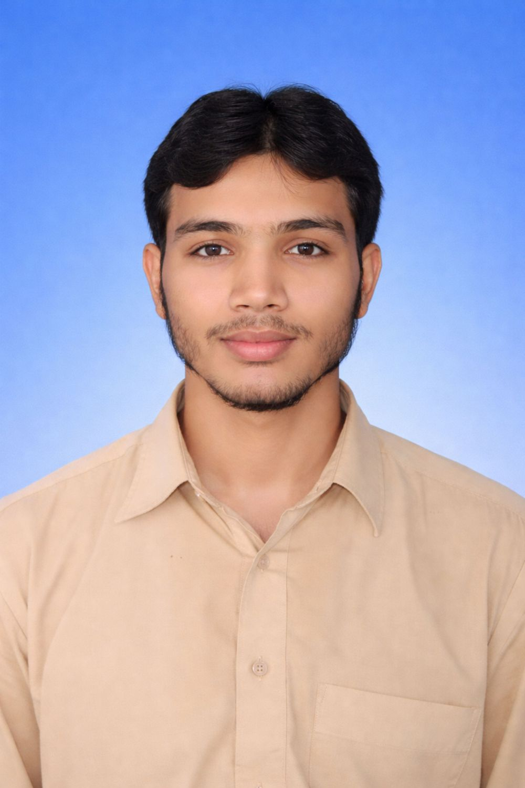
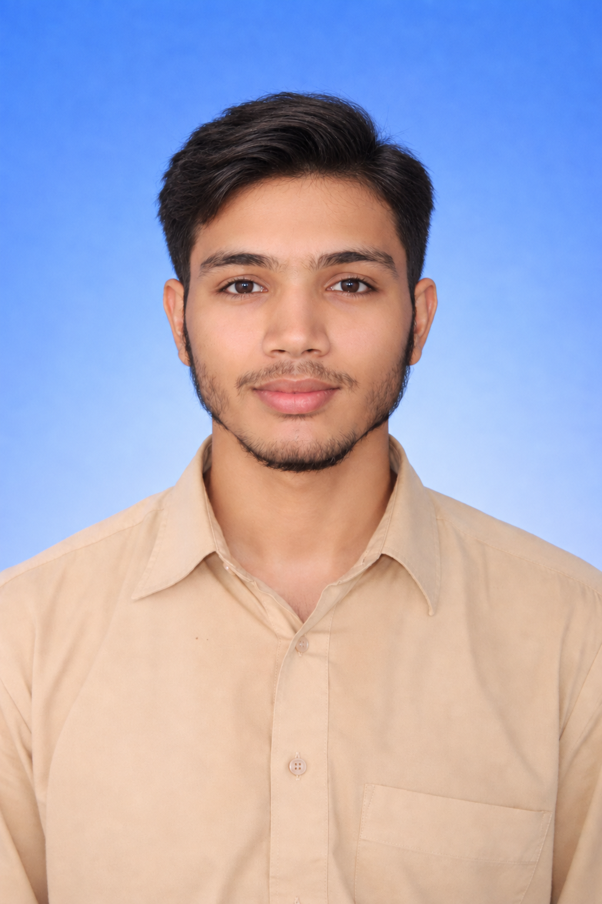
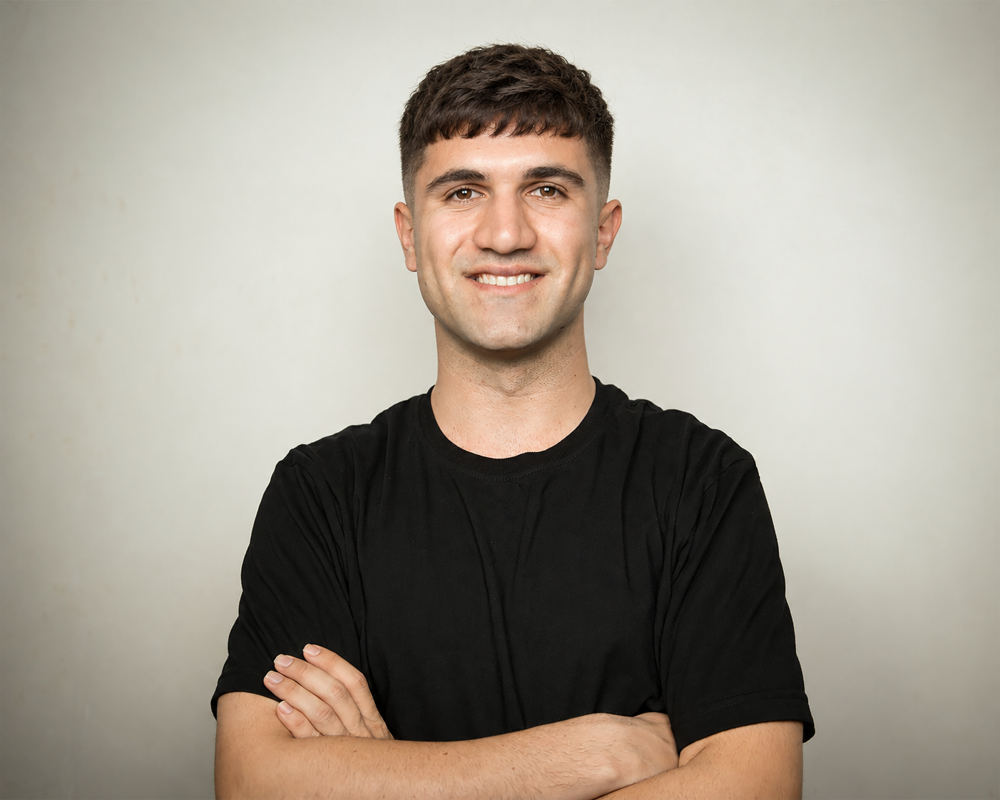
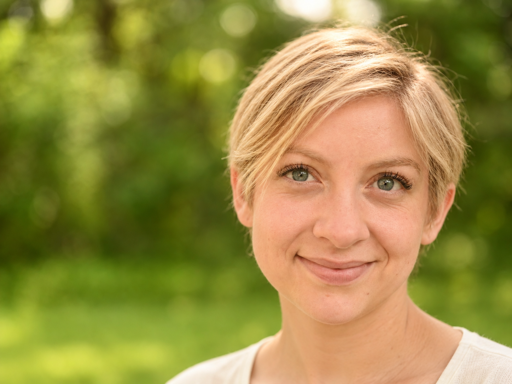
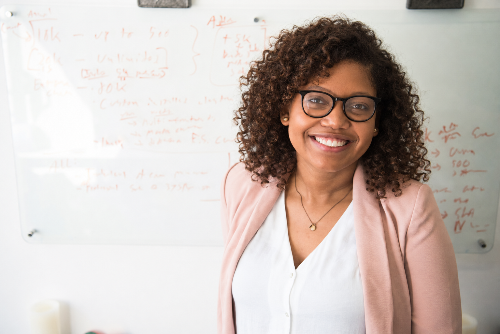

# Example gallery · 试戴案例

[English README](../README.md) · [中文 README](../README.zh-CN.md) · [Photo credits & image terms / 图片来源与许可](CREDITS.md)

**4 source portraits · 12 AI-generated results.** These are actual outputs from Codex built-in imagegen, generated on 2026-09-28 and 2026-10-12. Each result used its case's original portrait as the edit input. Click any image to inspect it at full resolution.

**4 张测试底图，12 张 AI 试戴效果图。** 以下为实际测试输出，每款均以对应原照为编辑底图。点击图片可查看大图。编号只在各自案例内有效，例如 P01 / H02 与 P02 / H02 是不同发型。

These are stock-photo demonstrations, not customer testimonials, real haircut before/after photos, or endorsements by the people shown. They illustrate the workflow, not a measured identity-preservation score or a guarantee of real-world styling results. Skin, clothing and background details may also be redrawn.

这些素材用于流程演示，不代表照片人物使用或推荐本项目，也不是真实剪发前后记录。脸部、皮肤、衣物和背景可能有生成重绘；没有计算身份相似度，未验证现实剪染效果。

[P01 · Side part / 自然侧分](#p01) · [P02 · Four styles / 四款男发](#p02) · [W02 · Length & color / 长度与发色](#w02) · [W03 · Curls & glasses / 卷发与眼镜](#w03)

## P01

**Natural side part · 自然侧分，保留黑发色** — 2026-09-28.

Photo / 原照：[Muhammad Arif / Pexels](https://www.pexels.com/photo/professional-portrait-of-young-adult-male-36652029/). One selected style; no canvas extension requested. 本组仅选择一款，未要求扩图。

| Original · 原照 | AI-generated try-on · AI 试戴 |
| --- | --- |
|  | **H02 · Natural side part / 自然侧分**  |

## P02

**Four silhouettes in natural chestnut brown · 四款轮廓，统一自然栗棕色** — 2026-09-28.

Photo / 原照：[Mostafa KordZangeneh / Unsplash](https://unsplash.com/photos/man-in-black-crew-neck-t-shirt-_tcJW4nqVtw). The original pose and near-5:4 framing provide a consistent basis for comparison. Style length and curl feasibility still require an in-person assessment. 各款保留近似 5:4 构图；留长、卷度与染色条件需现场判断。

| Original · 原照 | AI-generated try-on · AI 试戴 |
| --- | --- |
|  | **H01 · Textured French crop / 法式短碎刘海**  |
|  | **H02 · Curly fringe / 蓬松卷刘海**  |
|  | **H03 · Wavy middle part / 中长波浪中分**  |
|  | **H04 · Textured quiff / 哑光纹理上梳**  |

## W02

**Length, texture and color changes · 长度、纹理与发色变化** — 2026-10-12.

Photo / 原照：[Sibel Kusdemir / Unsplash](https://unsplash.com/photos/a-young-woman-with-blonde-hair-smiles-outdoors-nkRvJgdnc5c).

**Canvas extension:** the original is approximately 3:2. H01/H04 are 4:3; H02/H03 are square. Downward extension was explicitly requested when needed to show the complete hairstyle. Newly visible neck, shoulders, clothing and background are AI-inferred. Images below retain their individual aspect ratios, so their heights differ.

**扩图说明：**原照约为 3:2；H01/H04 为 4:3，H02/H03 为方图。测试中已明确允许按需向下扩图，新增颈肩、衣物和背景属于 AI 推测补全。下表保留各图原始比例，图片高度不同。

| Original · 原照 | AI-generated try-on · AI 试戴 |
| --- | --- |
|  | **H01 · French bob, warm chestnut / 暖栗棕法式波波**  |
|  | **H02 · Wavy lob, honey beige blonde / 蜂蜜米金波浪 Lob**  |
|  | **H03 · Layered shag, soft copper brown / 柔和铜棕层次 Shag**  |
|  | **H04 · Pixie, neutral sandy blonde / 中性沙金精灵短发**  |

## W03

**Curls, straight styling and glasses · 卷度变化、顺直造型与眼镜保留** — 2026-10-12.

Photo / 原照：[Christina @ wocintechchat.com M / Unsplash](https://unsplash.com/photos/smiling-woman-50TkCaP8M3A). No canvas extension; the glasses, smile and half-body framing remain recognizable. H03 may need more length; H04's straight look requires separate styling feasibility assessment. 未扩图；H03 的发长与 H04 的顺直处理方式仍需现场确认。

| Original · 原照 | AI-generated try-on · AI 试戴 |
| --- | --- |
|  | **H02 · Rounded coils, deep chocolate / 深巧克力棕圆形层次卷**  |
|  | **H03 · Side-parted curls, warm chestnut / 暖栗棕侧分及肩卷**  |
|  | **H04 · Sleek bob, cool deep brown / 冷调深棕内扣波波**  |

## Checks & scope · 检查范围

All 16 image files were decoded, visually reviewed, and copied byte-for-byte from the completed test deliveries; SHA-256 checks confirmed the copies. The gallery only arranges the images: no new portrait generation, cropping, retouching or color changes were performed for publication. The superseded P02 generation and unselected candidates are excluded.

16 个图片文件均已检查解码、逐张查看并与本地交付文件核对 SHA-256。此次整理只做页面排版，未重新生成、裁切、美化或改色。已排除 P02 的作废生成和未选候选。未验证用户本人自拍、真实剪染效果或量化身份保持指标。
