# Example gallery · 试戴案例

[English README](../README.md) · [中文 README](../README.zh-CN.md) · [Photo credits & image terms / 图片来源与许可](CREDITS.md)

**8 source portraits · 24 AI-generated results · WebP.** These are actual outputs from Codex built-in imagegen, generated on 2026-09-28, 2026-10-12 and 2026-10-13. Each result used its case's original portrait as the edit input. Click any image to inspect it at full resolution. JP01 comes from AIPX, which describes its portrait catalog as AI-generated.

**8 张测试底图，24 张 AI 试戴效果图，全部为 WebP。** 更新至 2026-10-13，每款均以对应原始底图为编辑依据。点击图片可查看大图。JP01 来自将其人物图库描述为 AI 生成的 AIPX，不作为真人自拍验证。编号只在各自案例内有效，例如 P01 / H02 与 P02 / H02 是不同发型。

These are stock-photo demonstrations, not customer testimonials, real haircut before/after photos, or endorsements by the people shown. They illustrate the workflow, not a measured identity-preservation score or a guarantee of real-world styling results. Skin, clothing and background details may also be redrawn.

这些素材用于流程演示，不代表照片人物使用或推荐本项目，也不是真实剪发前后记录。脸部、皮肤、衣物和背景可能有生成重绘；没有计算身份相似度，未验证现实剪染效果。

[CNM01 · Latest / 最新三款](#cnm01) · [JPM01 · Texture / 短碎与卷度](#jpm01) · [KR01 · Length / 短中长对比](#kr01) · [JP01 · Corrected finals / 修正后定稿](#jp01)

[P01 · Side part / 自然侧分](#p01) · [P02 · Four styles / 四款男发](#p02) · [W02 · Length & color / 长度与发色](#w02) · [W03 · Curls & glasses / 卷发与眼镜](#w03)

## CNM01

**Short texture, center part and curly wolf cut · 短发、中分与卷发狼尾** — 2026-10-13.

Source / 底图：[eskaylim / Unlimphotos 4702428](https://unlimphotos.com/4702428/young-man.html). Three final v1 results, each 1536 × 1024; no canvas extension. The original preview retains its watermark. In the generated results, the areas previously covered by it were reconstructed by the model, so this is not a hair-only pixel comparison.

三款均采用 v1，保持约 3:2 横向构图，未扩图。原始预览保留水印；成图中的水印覆盖区域经过模型补全，五官、皮肤及衣物细节可能随生成改变。

| Original preview · 原始预览 | AI-generated try-on · AI 试戴 |
| --- | --- |
|  | **H01 · Textured upswept short cut, black-brown / 自然黑棕露额束感短发** <a href="cnm01/h01.webp">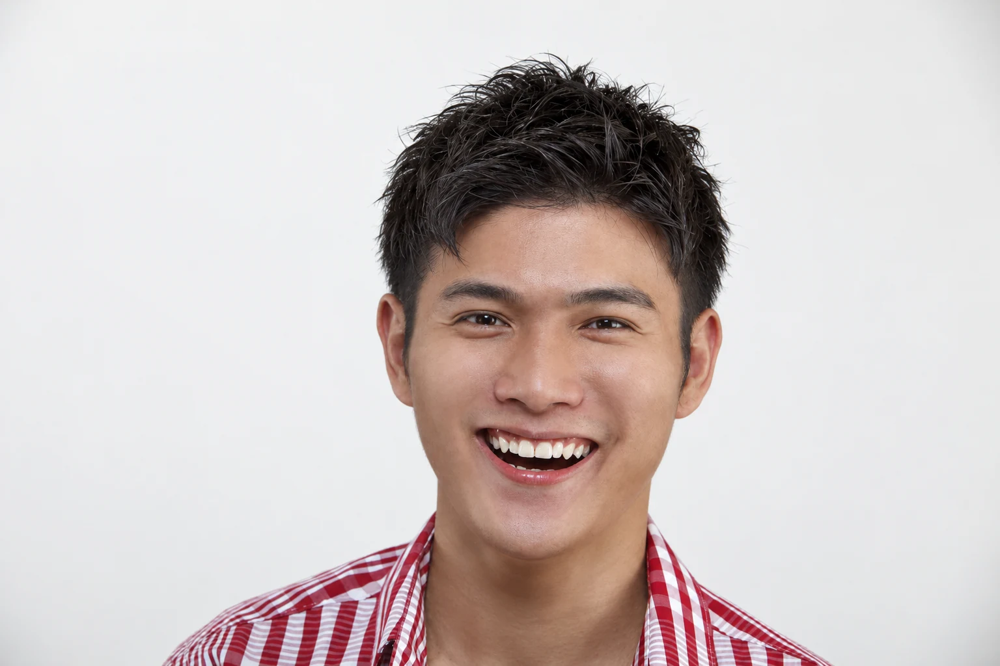</a> |
|  | **H02 · Natural center-parted flow, chocolate brown / 深巧克力棕自然中分** <a href="cnm01/h02.webp">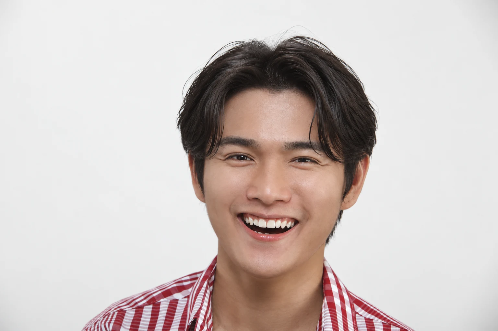</a> |
|  | **H04 · Curly wolf cut, soft chestnut / 柔和栗棕中长卷发狼尾**  |

## JPM01

**Short texture, soft center part and spiral curls · 短碎束感、中分微卷与螺旋卷** — 2026-10-12.

Source / 底图：[deeblue / Depositphotos 57376899](https://depositphotos.com/photo/young-japanese-man-57376899.html). Three final v1 results, each 1024 × 1536, with the original 2:3 framing and no canvas extension. The source preview retains its watermarks; covered regions and the hairline hidden by the original fringe are model-inferred in the results.

三款均采用 v1，保持 2:3 竖幅。原预览水印保留；结果中的水印覆盖区域及原刘海遮住的发际线由模型补全，不能据此验证像素级身份一致性。

| Original preview · 原始预览 | AI-generated try-on · AI 试戴 |
| --- | --- |
|  | **H01 · Short textured cut, smoky dark brown / 烟灰深棕短碎束感** <a href="jpm01/h01.webp">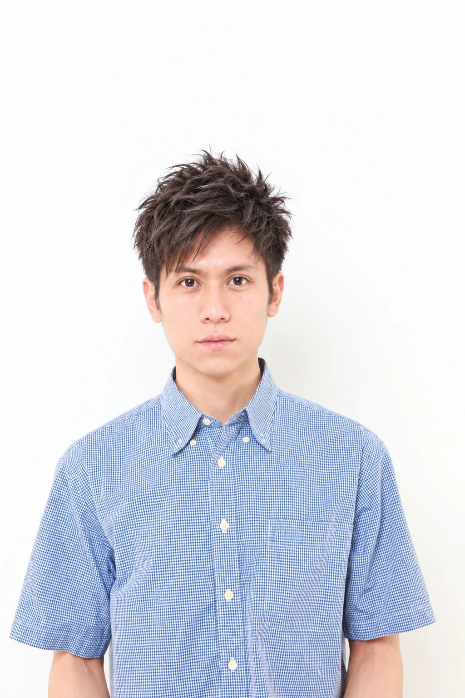</a> |
|  | **H02 · Soft center-parted waves, chocolate brown / 深巧克力棕露额中分微卷** <a href="jpm01/h02.webp">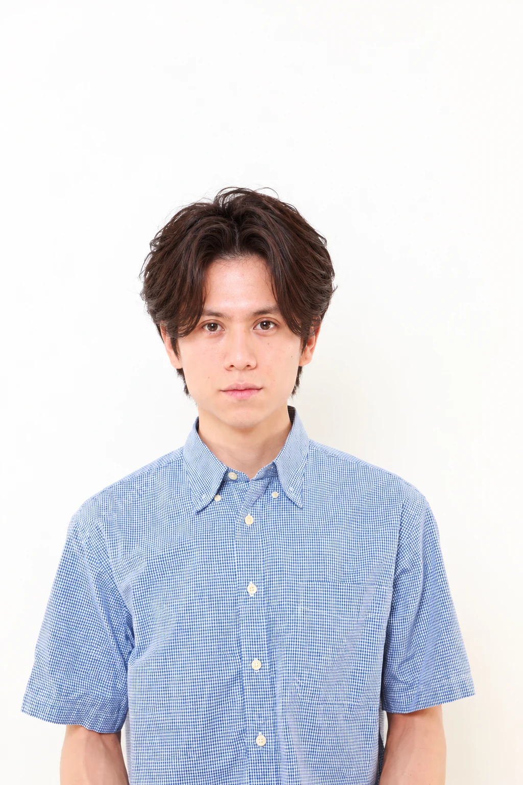</a> |
|  | **H03 · Spiral curls, cool dark brown / 冷调深棕蓬松螺旋卷**  |

## KR01

**Blunt bob, collarbone layers and long S-waves · 直线波波、锁骨层次与长发大卷** — 2026-10-12.

Source / 底图：[amazingmikael / Depositphotos 370595680](https://depositphotos.com/photo/studio-shot-young-beautiful-korean-businesswoman-white-background-370595680.html). Three final v1 results, each 994 × 1582, preserving the original portrait aspect ratio without extending the canvas. The original preview retains watermarks and its bottom source banner; the corresponding areas in the results were reconstructed by the model.

三款均采用 v1，未扩图，保留竖幅、微笑及交叉双臂构图。原预览保留水印和底部品牌条；成图对应区域由模型补全，不代表取得了无水印原片。

| Original preview · 原始预览 | AI-generated try-on · AI 试戴 |
| --- | --- |
|  | **H02 · Blunt bob, milk-tea beige brown / 奶茶米棕齐刘海直线波波**  |
|  | **H03 · Airy collarbone layers, soft copper brown / 柔和铜棕锁骨层次空气卷** <a href="kr01/h03.webp">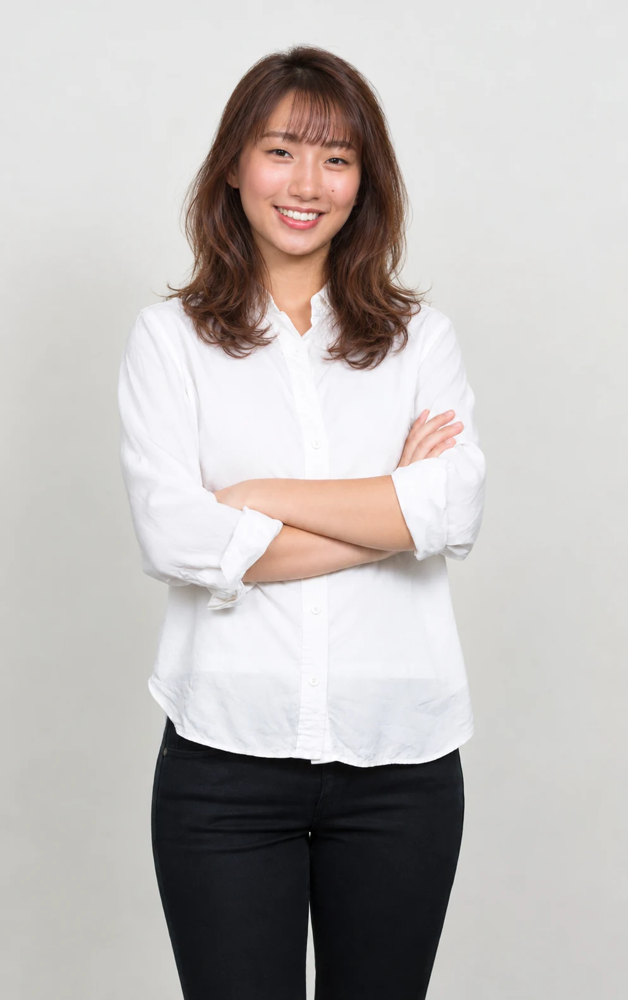</a> |
|  | **H04 · Long S-waves, chocolate brown / 深巧克力棕长发蓬松 S 卷** <a href="kr01/h04.webp">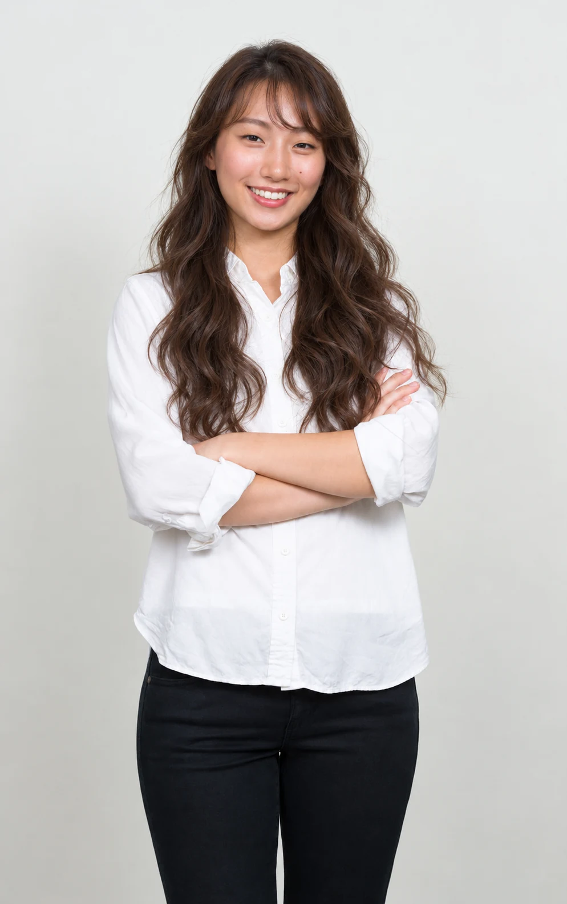</a> |

## JP01

**Rounded bob, collarbone layers and long waves · 圆弧短波波、锁骨层次与长层次松卷** — 2026-10-12.

Source / 底图：[AIPX 10065](https://aipx.jp/photo.php?id=10065). [AIPX describes its portrait catalog as AI-generated](https://aipx.jp/about.php); this case is not evidence of testing on a real user's selfie. H01 uses final v1 (1536 × 1024); H03 and H04 use corrected v2 (1448 × 1086). The superseded v1 results are not included.

**Canvas extension:** H03 was corrected to reach below the collarbones; H04 was corrected to restore the landscape composition and keep all hair tips in frame. The downward/rightward extension includes inferred shoulders, clothing and background. The original source is 1200 × 800; images retain their respective aspect ratios.

**定稿与扩图：**H01 采用 v1；H03、H04 采用 v2，分别修正发长及横向构图。向下、向右新增的肩部、衣物和背景属于推测生成内容。未收录两张已被替代的初版；不同图片按各自原比例展示。

| Original source · 原始底图 | AI-generated try-on · AI 试戴 |
| --- | --- |
|  | **H01 · Rounded bob, muted ash brown · v1 / 柔雾灰棕圆弧短波波** <a href="jp01/h01.webp">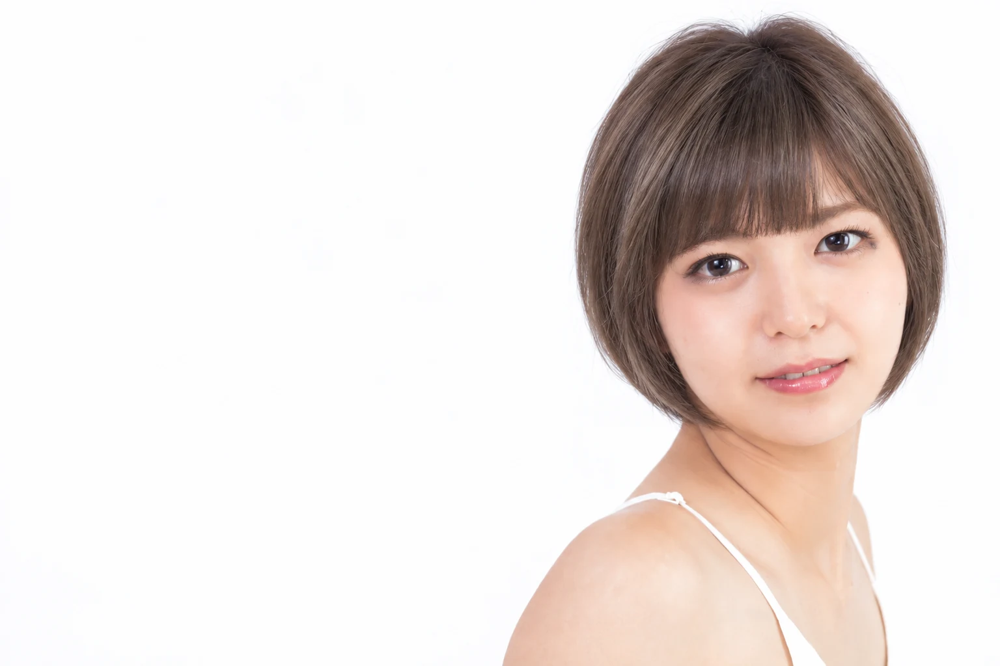</a> |
|  | **H03 · Collarbone layers, rose brown · v2 / 玫瑰棕锁骨层次微弯**  |
|  | **H04 · Long layered waves, mocha brown · v2 / 摩卡棕胸前长层次松卷** <a href="jp01/h04.webp">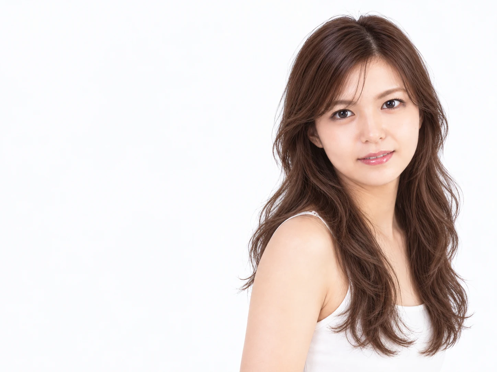</a> |

## P01

**Natural side part · 自然侧分，保留黑发色** — 2026-09-28.

Photo / 原照：[Muhammad Arif / Pexels](https://www.pexels.com/photo/professional-portrait-of-young-adult-male-36652029/). One selected style; no canvas extension requested. 本组仅选择一款，未要求扩图。

| Original · 原照 | AI-generated try-on · AI 试戴 |
| --- | --- |
|  | **H02 · Natural side part / 自然侧分**  |

## P02

**Four silhouettes in natural chestnut brown · 四款轮廓，统一自然栗棕色** — 2026-09-28.

Photo / 原照：[Mostafa KordZangeneh / Unsplash](https://unsplash.com/photos/man-in-black-crew-neck-t-shirt-_tcJW4nqVtw). The original pose and near-5:4 framing provide a consistent basis for comparison. Style length and curl feasibility still require an in-person assessment. 各款保留近似 5:4 构图；留长、卷度与染色条件需现场判断。

| Original · 原照 | AI-generated try-on · AI 试戴 |
| --- | --- |
|  | **H01 · Textured French crop / 法式短碎刘海** <a href="p02/h01.webp">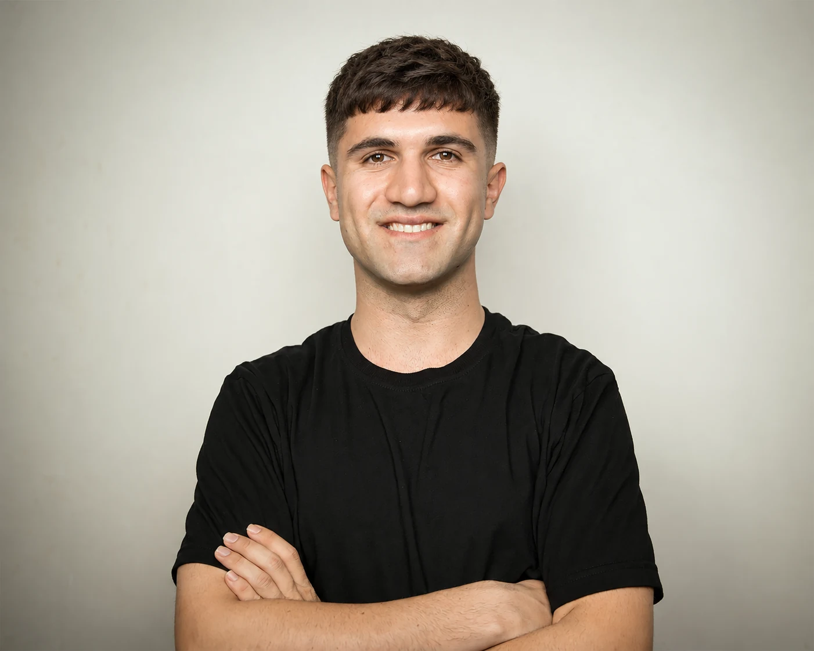</a> |
|  | **H02 · Curly fringe / 蓬松卷刘海**  |
|  | **H03 · Wavy middle part / 中长波浪中分** <a href="p02/h03.webp">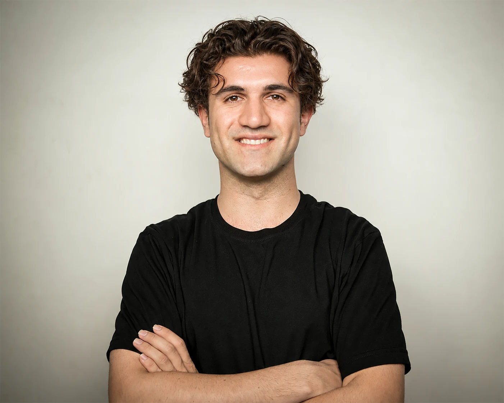</a> |
|  | **H04 · Textured quiff / 哑光纹理上梳** <a href="p02/h04.webp">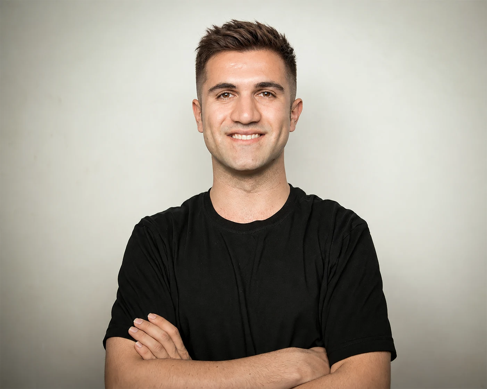</a> |

## W02

**Length, texture and color changes · 长度、纹理与发色变化** — 2026-10-12.

Photo / 原照：[Sibel Kusdemir / Unsplash](https://unsplash.com/photos/a-young-woman-with-blonde-hair-smiles-outdoors-nkRvJgdnc5c).

**Canvas extension:** the original is approximately 3:2. H01/H04 are 4:3; H02/H03 are square. Downward extension was explicitly requested when needed to show the complete hairstyle. Newly visible neck, shoulders, clothing and background are AI-inferred. Images below retain their individual aspect ratios, so their heights differ.

**扩图说明：**原照约为 3:2；H01/H04 为 4:3，H02/H03 为方图。测试中已明确允许按需向下扩图，新增颈肩、衣物和背景属于 AI 推测补全。下表保留各图原始比例，图片高度不同。

| Original · 原照 | AI-generated try-on · AI 试戴 |
| --- | --- |
|  | **H01 · French bob, warm chestnut / 暖栗棕法式波波**  |
|  | **H02 · Wavy lob, honey beige blonde / 蜂蜜米金波浪 Lob** <a href="w02/h02.webp">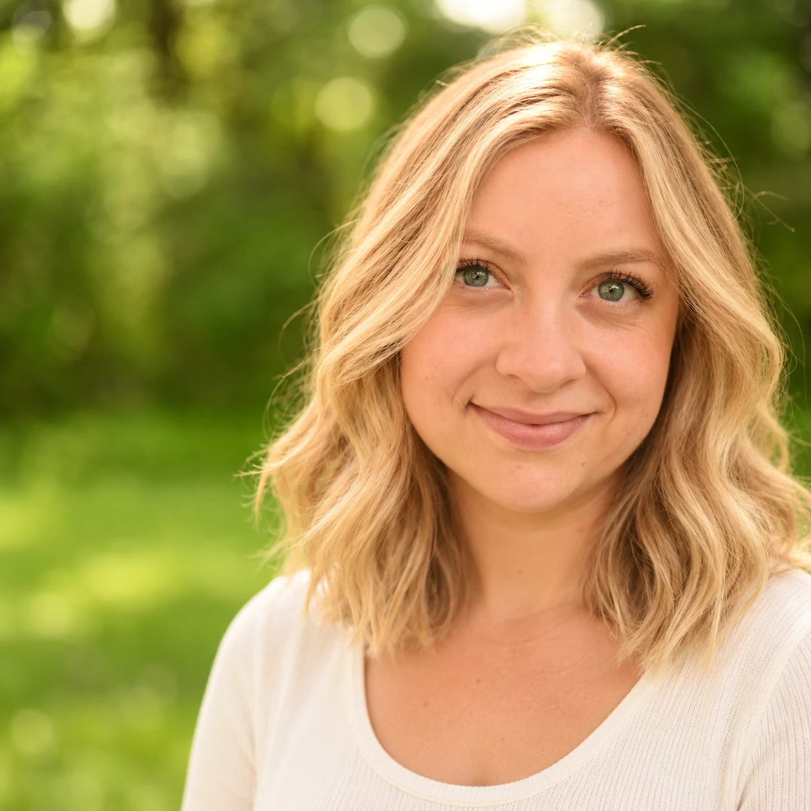</a> |
|  | **H03 · Layered shag, soft copper brown / 柔和铜棕层次 Shag** <a href="w02/h03.webp">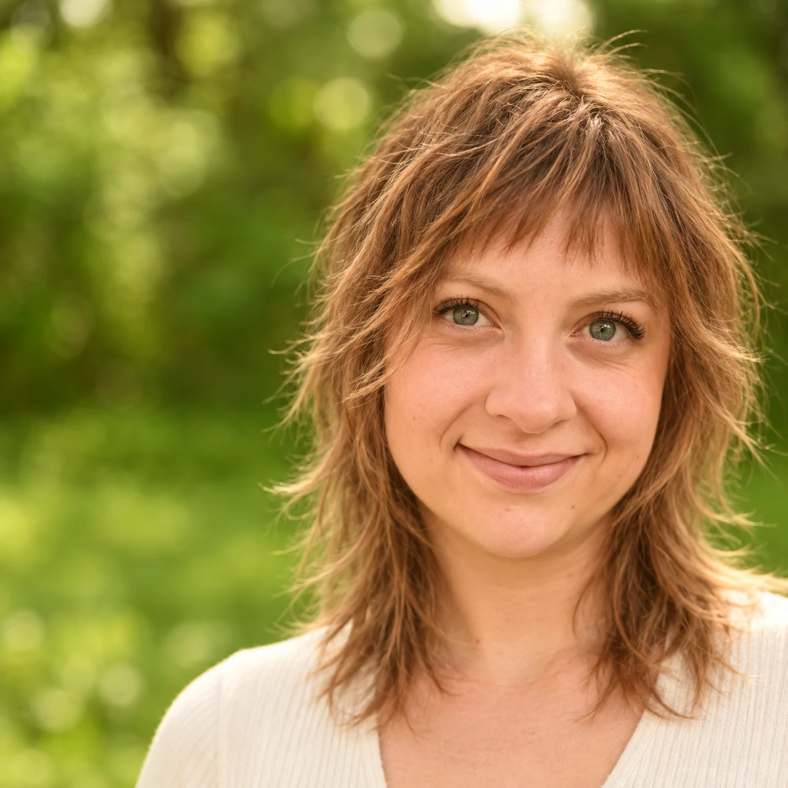</a> |
|  | **H04 · Pixie, neutral sandy blonde / 中性沙金精灵短发**  |

## W03

**Curls, straight styling and glasses · 卷度变化、顺直造型与眼镜保留** — 2026-10-12.

Photo / 原照：[Christina @ wocintechchat.com M / Unsplash](https://unsplash.com/photos/smiling-woman-50TkCaP8M3A). No canvas extension; the glasses, smile and half-body framing remain recognizable. H03 may need more length; H04's straight look requires separate styling feasibility assessment. 未扩图；H03 的发长与 H04 的顺直处理方式仍需现场确认。

| Original · 原照 | AI-generated try-on · AI 试戴 |
| --- | --- |
|  | **H02 · Rounded coils, deep chocolate / 深巧克力棕圆形层次卷** <a href="w03/h02.webp">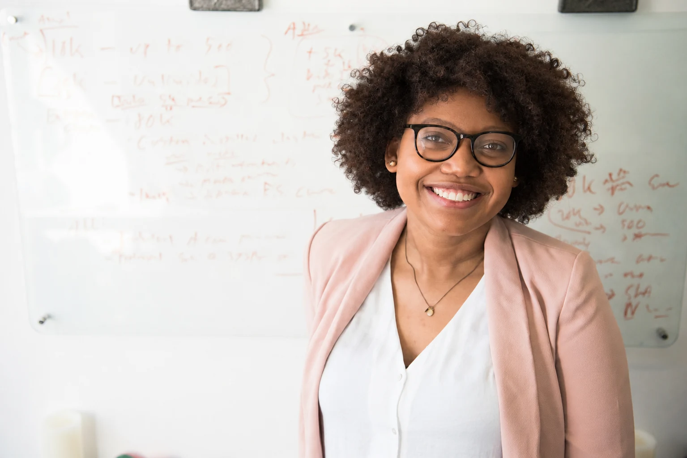</a> |
|  | **H03 · Side-parted curls, warm chestnut / 暖栗棕侧分及肩卷** <a href="w03/h03.webp">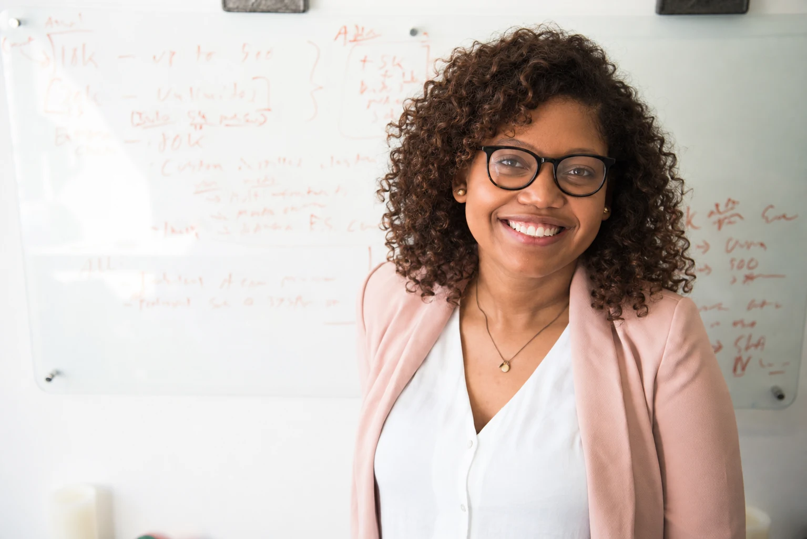</a> |
|  | **H04 · Sleek bob, cool deep brown / 冷调深棕内扣波波**  |

## Checks & scope · 检查范围

All 32 published images are lossy WebP copies of the final test deliveries, with their original pixel dimensions, aspect ratios and embedded color profiles preserved. Encoding quality is 88, except the CNM01/JPM01 source previews at 82 to keep them smaller than their already compressed JPEGs. Total image size is 3.12 MiB. The 16 files added on 2026-10-13 shrank from 22.83 MiB to 1.64 MiB (92.81% smaller). All files were decoded and checked against their source dimensions; the new comparisons were visually reviewed. The original JPEG/PNG files remain in the local test deliveries. No new portraits, cropping or retouching were added for publication. Superseded P02 and JP01 results and unselected candidates are excluded.

32 个公开图片文件均为最终交付的 WebP 有损压缩副本，保留原始像素尺寸、比例及内嵌色彩配置。编码质量为 88，CNM01/JPM01 的底图预览采用 82，以小于已有压缩 JPEG 的体积。图库总计 3.12 MiB；2026-10-13 新增的 16 个文件从 22.83 MiB 降至 1.64 MiB，减少 92.81%。文件均已检查解码和对应源图尺寸，新增对比已目视检查；原始 JPEG/PNG 保留在本地。发布时未重新生成、裁切或修饰人像，已排除 P02、JP01 的作废版本及未选候选。未验证用户本人自拍、真实剪染效果或量化身份保持指标。
